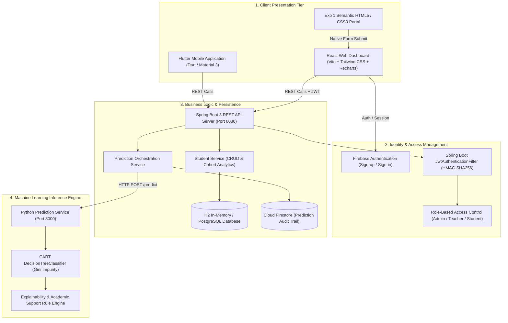

# System Architecture & Technical Design

## Overview
**Predicting Student Academic Performance Using Decision Tree — Machine Learning for Educational Institutions**  
**SDG Alignment:** SDG 4 – Quality Education (Target 4.1 & 4.4)

The platform is designed as an explainable, data-informed educational early warning system. It integrates modern web technologies, machine learning inference, secure authentication, cloud databases, Kotlin OOP/exception demonstrations, and a companion Flutter mobile application into a unified institution dashboard.

---

## Architecture Diagram

---

## Data Flow Pipeline

1. **Student Registration / Update**:
   - An educator enters student academic and attendance indicators via the React web form, the HTML5 Exp 1 form, or the Flutter mobile application.
   - The payload is validated using Jakarta Validation constraints (`@Min`, `@Max`, `@NotBlank`, `@Email`).
   - The Spring Boot backend persists the record and invokes the ML service.

2. **Decision Tree Classification**:
   - Features (`attendance_percentage`, `study_hours_per_day`, `previous_marks`, `assignment_completion`, `internal_marks`, `missed_classes`) are fed into the Decision Tree CART pipeline.
   - The model evaluates tree splits based on Gini impurity reduction.
   - The model classifies the student into **Low**, **Average**, or **Good** performance tier.

3. **Explainability & Pedagogical Action**:
   - The tree traversal path is recorded (e.g. `attendance_percentage <= 60%`).
   - Contributing risk factors and actionable recommendations (faculty attendance mentoring, peer-tutoring clinics, study scheduling) are generated.
   - The outcome is saved in the persistent database and logged to Cloud Firestore for audit compliance.

4. **Early Warning Dashboard**:
   - Aggregated metrics update in real-time.
   - Students with attendance `< 75%` or `Low` predicted tier appear on the **At-Risk Students** dashboard for faculty intervention.
